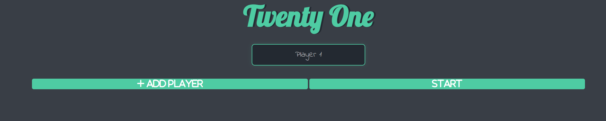

# twenty-one-dice-game

The objective of the game is to score the highest roll in a set of a maximum of three rolls.

## The turn order
The turn starts with a round leader, they will roll the dice separately or both for a maximum of three rolls, after those rolls the turn will advance. 

The number of rolls used by the first person in the round determines the number of rolls that other players can use.

The player with the highest score at the end of the round wins the round

## Dice Scoring
In scoring, the higher number always goes first, a `[3][5]` is actually a scored `[5][3]` because the five can be placed before the three. 

Doubles are 100s, `[4][4] = [400]` 

The special roll is `[2][1]` which counts as the highest roll.

